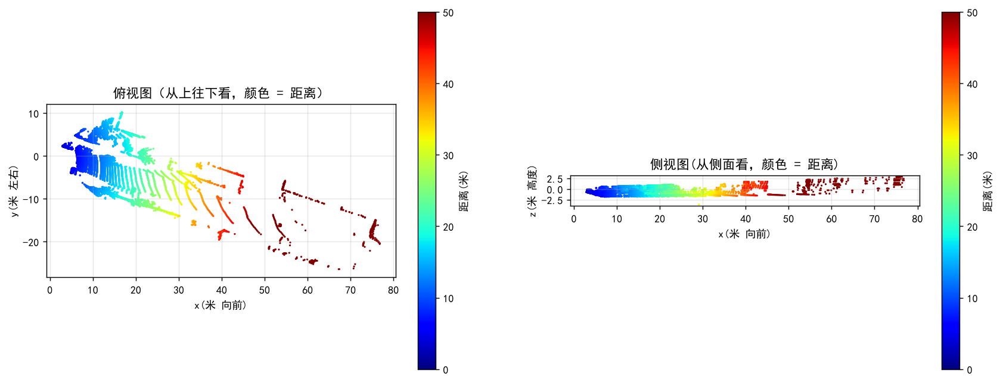
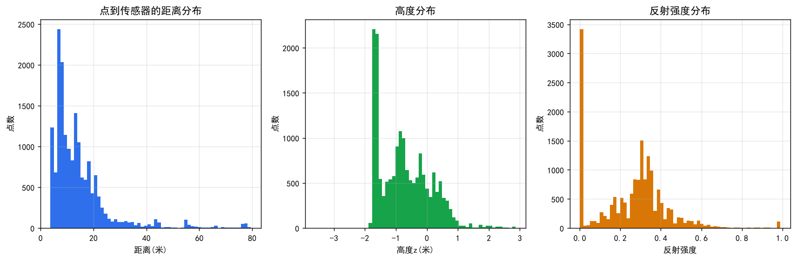

# KITTI 点云分析

用 Python 处理 KITTI 自动驾驶数据集的车载激光雷达点云，完成从数据读取、统计分析、体素降采样到可视化的完整流程。

## 数据

样本取自 [KITTI](https://www.cvlibs.net/datasets/kitti/) 3D 目标检测数据集（帧 000008），仅用于学习与研究：

> **数据来源**：A. Geiger, P. Lenz, R. Urtasun. *Are we ready for Autonomous Driving? The KITTI Vision Benchmark Suite*. CVPR 2012.
>
> **数据许可**：[CC BY-NC-SA 3.0](https://creativecommons.org/licenses/by-nc-sa/3.0/)（署名 — 非商业性使用 — 相同方式共享）。
> `data/` 目录下的 KITTI 样本按其原始许可证分发，仅限非商业用途。

| 文件 | 说明 |
|---|---|
| `data/kitti_000008.bin` | 激光雷达点云，17238 个点，每点含 x / y / z / 反射强度 |
| `data/kitti_000008_camera.png` | 同一时刻的相机图像 |
| `data/kitti_000008_label.txt` | 目标标注 |

## 做了什么

| 步骤 | 内容 | 结果 |
|---|---|---|
| 1. 读取 | 用 numpy 解析 KITTI 二进制格式 | 17238 × 4 |
| 2. 统计 | 坐标范围、距离分布 | 最远 79.5 米，平均 14.4 米 |
| 3. 降采样 | 自己实现体素降采样（voxel downsampling） | 0.5 米体素 → 1975 个点 |
| 4. 可视化 | 俯视图 / 侧视图、分布直方图 | 见 `figures/` |

## 结果展示

### 点云俯视图与侧视图

### 三个分布直方图

## 主要结论

1. **点云分布极不均匀**：10 米以内的点占 43.4%，30 米以外只占 6.7%
2. **原因**：激光雷达角分辨率固定，距离越远相邻光束间隔越大，同一目标上的点数越少
3. **对检测的影响**：远距离目标只有零星几个点，容易被噪声淹没 —— 这是远距离小目标检测的核心难点
4. **体素降采样效果**：0.5 米体素把 17238 个点降到 1975 个（压缩到 11%），整体形状基本保持不变

## 文件说明

| 路径 | 说明 |
|---|---|
| `kitti_pointcloud.ipynb` | 全部代码（含注释） |
| `figures/` | 输出的图表与统计表 |
| `data/` | KITTI 样本数据 |

## 环境

- Python 3.14
- numpy / pandas / matplotlib

## 后续计划

- [ ] 加地面分割（RANSAC 拟合地面平面）
- [ ] 加聚类（欧氏聚类，把点分成一个个物体）
- [ ] 换成真实 3D 检测模型（PointPillars / CenterPoint）
